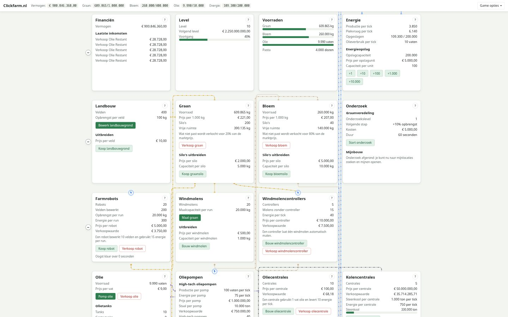
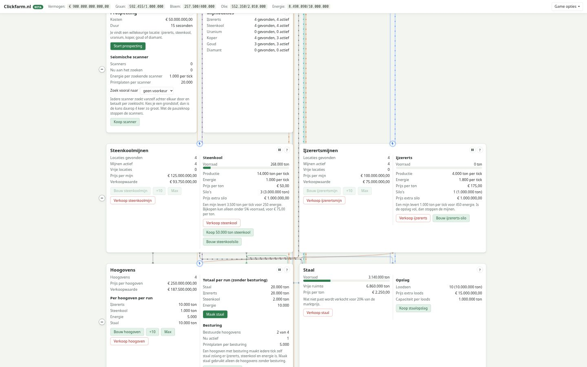

# Clickfarm
Clickfarm is een gratis idle- en klikspel dat helemaal in je browser draait. Je begint met één veld graan en bouwt via molens, kippen, pasta, olie, staal en kernenergie een industrieel imperium op. In de beta loopt het door tot koper, elektronica, goud, diamant en een datacenter dat de munt AICoin oplevert.

**Spelen:** [clickfarm.nl](https://clickfarm.nl) · **Nieuwste onderdelen uitproberen:** [clickfarm.nl/beta](https://clickfarm.nl/beta/) · **Spelinformatie:** [clickfarm.nl/info.html](https://clickfarm.nl/info.html)

Geen account, geen advertenties en geen tracking: je spel staat in je eigen browser.





# Hoe is het begonnen
Ik wilde graag weten hoe ver ik zou komen als ik zelf iets in HTML/CSS/Javascript zou schrijven, en dat pakte uiteindelijk iets uitgebreider uit dan ik verwacht had moet ik zeggen.

Wat werd opgevolgd met deze forumpost en de ruim 2.000 reacties die daar op volgden: https://gathering.tweakers.net/forum/list_messages/1834443

Het spel is open source. Bijdragen, bugmeldingen en ideeën zijn welkom via de [issues](https://github.com/HermanRonk/Clickfarm/issues) of in het topic op Tweakers.

# Wat moet er gebeuren
De actuele lijst staat in de [issues](https://github.com/HermanRonk/Clickfarm/issues). De grote lijnen:

- de beta (level 12 tot en met 16) testen met spelers en daarna naar het gewone spel brengen (#84);
- de resterende mijnen (#48) zijn in de beta gebouwd en gaan mee met #84;
- bugfixing en documentatie;
- de startcapaciteit van de olieopslag is te groot.

# Hoe werkt het
Clickfarm draait volledig in de browser, er is geen backend of database (meer) nodig:

- De voortgang wordt opgeslagen in de `localStorage` van de browser.
- Marktprijzen (olie, graan, meel) en de voorraad op de markt (eieren, staal, splijtstofstaven) worden in de browser bepaald.
- Via *Game opties → Exporteer save-code* kopieer je je savegame naar het klembord. Met *Importeer save-code* zet je hem weer terug, ook in een andere browser.

## Beta
Nieuwe onderdelen en balanswijzigingen komen eerst in de beta (`/beta/`, via *Game opties → Probeer de beta*). Het is hetzelfde spel: `inc/base.js` herkent de beta aan het pad (`BETA`), en `/beta/spel.html` serveert gewoon `index.html` (zie `nginx.conf`).

- De beta bewaart zijn spel los van het gewone spel: alle sleutels krijgen `beta:` ervoor (`store` in `inc/base.js`). Een reset of save-code raakt alleen het eigen spel.
- Op de keuzepagina neem je je huidige spel mee (een kopie) of begin je opnieuw.
- Wijzigingen staan achter `if (BETA)`. Gaat een wijziging naar het gewone spel, dan haal je die voorwaarde weg.

De bestanden:

| Pad | Inhoud |
| --- | --- |
| `index.html` | De pagina, inclusief de iconen (geen externe bibliotheken of CDN) |
| `info.html` | Spelinformatie: hoe het spel werkt en wat ieder level brengt |
| `beta/index.html` | Keuzepagina van de beta: je huidige spel meenemen of opnieuw beginnen |
| `inc/base.js` | Alle spellogica |
| `css/style.css` | Alle opmaak, met automatisch donker thema |
| `Dockerfile`, `nginx.conf` | Container die de statische bestanden serveert |
| `tests/`, `package.json`, `playwright.config.js` | End-to-end tests (gaan niet mee in de container) |
| `docs/screenshots/` | Schermafbeeldingen voor deze README (gaan niet mee in de container) |

# Zelf draaien
Zonder installatie: open `index.html` in je browser, of start een simpele webserver in de map, bijvoorbeeld:

```
python3 -m http.server 8080
```

De beta (`/beta/spel.html`) bestaat niet als bestand: nginx serveert er `index.html` voor. Lokaal werkt hij met Docker (hieronder) of met de testserver: `node tests/helpers/serve.js` (http://localhost:8081).

Met Docker:

```
docker build -t clickfarm .
docker run --rm -p 8080:8080 clickfarm
```

Ga daarna naar http://localhost:8080. De container luistert op poort `8080`, draait niet als root en heeft een health check op `/healthz`.

# Testen
De tests bespelen het spel in een echte browser (Playwright): levelen, welke onderdelen per level zichtbaar worden, spelverloop, opslaan/laden en eerder opgeloste bugs.

```
npm ci
npx playwright install chromium
npm test              # tegen een lokale server
npm run test:docker   # tegen de gebouwde productie-container
```

Bij iedere pull request en push naar `master` draaien de tests automatisch in GitHub Actions; het rapport staat als artifact bij de run. Zie [`tests/README.md`](tests/README.md) voor alle details.
